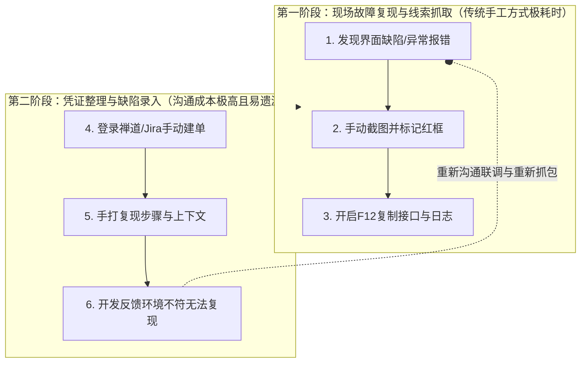
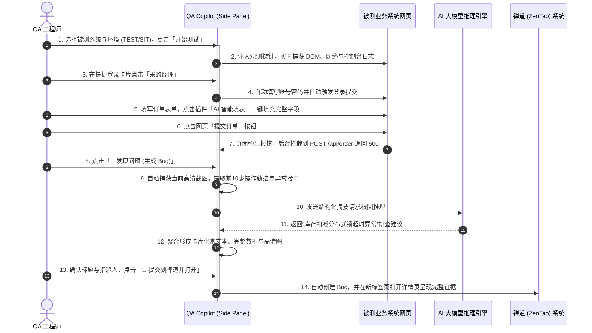
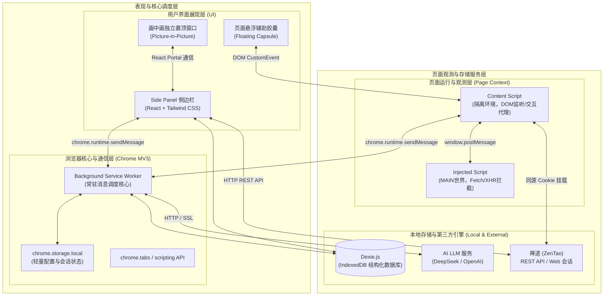
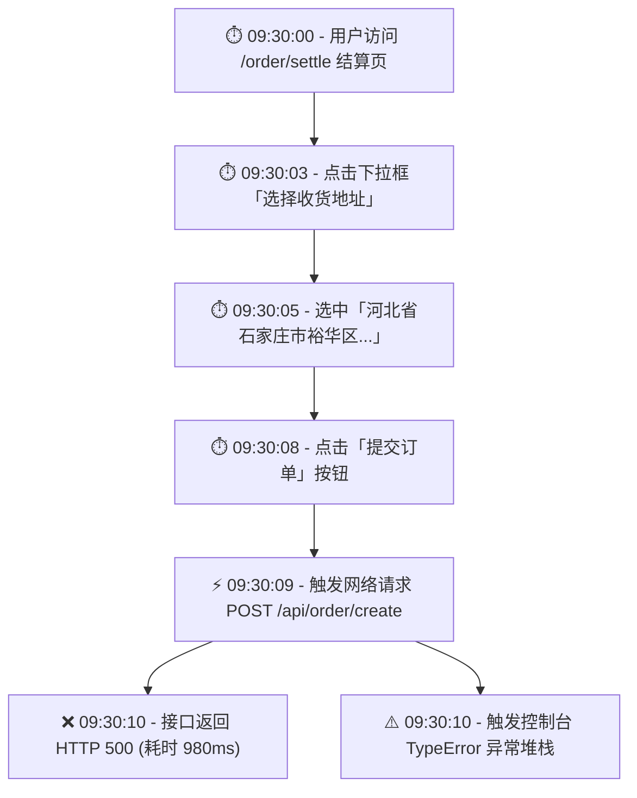
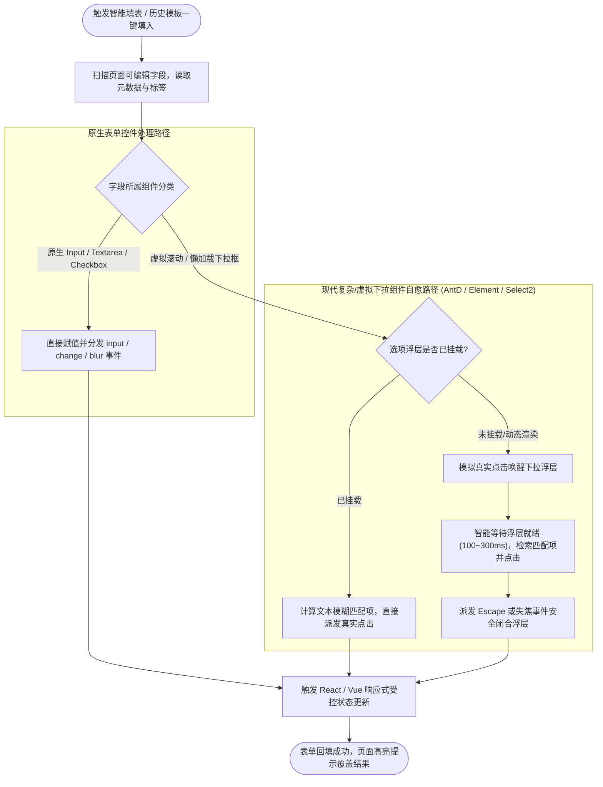
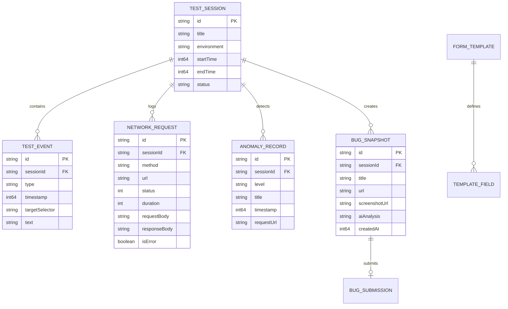
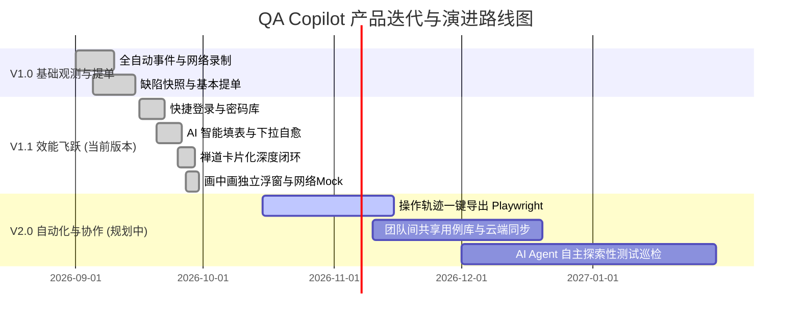

# QA Copilot 智能测试助手 Chrome 插件产品需求文档 (PRD)

| 文档版本 | 发布日期 | 编写人 | 适用范围 | 状态 |
| :--- | :--- | :--- | :--- | :--- |
| **V1.1.0** | 2026-09-30 | QA Copilot 架构与产品团队 | Web QA 工程师、前端与后端开发、测试主管 | 正式发布 |

---

## 目录

- [一、文档元信息与版本历史](#一文档元信息与版本历史)
- [二、产品概述与业务定位](#二产品概述与业务定位)
  - [2.1 业务背景与行业痛点](#21-业务背景与行业痛点)
  - [2.2 产品愿景与核心价值](#22-产品愿景与核心价值)
  - [2.3 产品能力边界与协同定位](#23-产品能力边界与协同定位)
- [三、用户画像与典型使用场景](#三用户画像与典型使用场景)
  - [3.1 用户角色画像](#31-用户角色画像)
  - [3.2 典型端到端业务使用旅程](#32-典型端到端业务使用旅程)
- [四、系统总体架构设计](#四系统总体架构设计)
  - [4.1 Chrome MV3 模块协同架构](#41-chrome-mv3-模块协同架构)
  - [4.2 核心数据流转时序图](#42-核心数据流转时序图)
- [五、核心功能模块详细需求规范](#五核心功能模块详细需求规范)
  - [5.1 全自动现场感知与事件观测录制](#51-全自动现场感知与事件观测录制)
  - [5.2 快捷登录与多账号角色管理](#52-快捷登录与多账号角色管理)
  - [5.3 AI 智能填表与复杂组件交互自愈](#53-ai-智能填表与复杂组件交互自愈)
  - [5.4 现场快照打包与 AI 智能根因分析](#54-现场快照打包与-ai-智能根因分析)
  - [5.5 禅道 (ZenTao) 缺陷管理平台深度集成](#55-禅道-zentao-缺陷管理平台深度集成)
  - [5.6 画中画 (PiP) 独立置顶悬浮窗体系](#56-画中画-pip-独立置顶悬浮窗体系)
  - [5.7 API 接口拦截、Mock 与单步重放调试](#57-api-接口拦截mock-与单步重放调试)
  - [5.8 智能测试用例与边界数据生成](#58-智能测试用例与边界数据生成)
  - [5.9 隐私合规与数据安全脱敏机制](#59-隐私合规与数据安全脱敏机制)
- [六、本地数据模型与持久化设计](#六本地数据模型与持久化设计)
  - [6.1 数据存储架构 (Dexie.js / IndexedDB)](#61-数据存储架构-dexiejs--indexeddb)
  - [6.2 核心实体关系表设计](#62-核心实体关系表设计)
- [七、非功能性需求 (NFR)](#七非功能性需求-nfr)
  - [7.1 性能与资源消耗指标](#71-性能与资源消耗指标)
  - [7.2 稳定性与错误容灾策略](#72-稳定性与错误容灾策略)
  - [7.3 浏览器与操作系统兼容性](#73-浏览器与操作系统兼容性)
- [八、版本规划与演进路线](#八版本规划与演进路线)

---

## 一、文档元信息与版本历史

### 1.1 版本演进记录

| 版本号 | 修订日期 | 修订内容摘要 | 修订人 | 审核人 |
| :--- | :--- | :--- | :--- | :--- |
| **V1.0.0** | 2026-09-03 | 初始功能定义，确定 Chrome MV3 Side Panel 架构与基础观测功能 | 产品团队 | 技术委员会 |
| **V1.0.5** | 2026-09-15 | 增加 AI 智能填表引擎、多系统快捷登录支持与复杂 DOM 自愈设计 | 研发团队 | 测试负责人 |
| **V1.1.0** | 2026-09-30 | 完善禅道卡片化提单集成、完整可滚动 API 数据呈现、画中画置顶窗、网络 Mock 体系 | 全体团队 | 项目总监 |

---

## 二、产品概述与业务定位

### 2.1 业务背景与行业痛点

在现代软件研发体系中，Web 前端复杂度日益攀升，单页面应用 (SPA)、微前端与富交互表单极其普遍。QA 工程师在日常功能测试与探索性测试中，面临如下巨大痛点：



- **证据收集繁琐冗长**：QA 发现问题后，需要截屏、打开 DevTools 过滤报错请求、复制响应 JSON、复制 Console 堆栈，平均提交一个有效 Bug 耗时 **5~10 分钟**。
- **复现步骤容易失真**：QA 靠记忆手写复现步骤，常常遗漏前置操作（如特定下拉选项或特定用户身份），导致开发人员拿到 Bug 后回复“无法复现”或反复拉扯沟通。
- **大表单录入极其费时**：面对拥有几十甚至上百个表单项的企业级业务系统，测试人员每次都要手工填写海量数据，反复输入导致疲劳且测试用例覆盖度有限。
- **环境账号切换繁琐**：在微服务多角色系统中，需要频繁在管理员、普通用户、审核员之间切换，账号密码输入极度浪费时间。

### 2.2 产品愿景与核心价值

**QA Copilot** 是一款专为 Web QA 工程师量身打造的 Chrome 浏览器扩展。其核心愿景不是替代 Selenium、Playwright 或 Postman 等专业自动化/接口工具，而是成为测试工程师日常工作中的 **“第二副驾驶”**，专注于消除所有低价值的机械重复劳动。

> **核心价值宣言**：让 QA 工程师不再手工整理测试证据，一键生成研发无法推脱的高保真缺陷报告。

| 评估维度 | 传统手工测试与提单方式 | QA Copilot 赋能模式 | 效能提升幅度 |
| :--- | :--- | :--- | :--- |
| **单 Bug 提交耗时** | 5 ~ 10 分钟（找接口、截屏、码字） | **< 30 秒**（一键点击「发现问题」自动打包） | **提效 90% 以上** |
| **缺陷证据完整度** | 依赖测试人员自觉，经常漏掉 Header/Body | 自动附带点击路径、精准异常接口、完整响应体、Console 堆栈与环境信息 | **100% 完整复现链条** |
| **大表单填单耗时** | 2 ~ 5 分钟逐项手敲 | **1 秒内** 智能推断或历史模板自动一键填入 | **提效 95%** |
| **账号身份切换** | 记密码、登出、重新输入登录 | 侧边栏/置顶窗 **一键免密秒级切换** | **秒级切换** |

### 2.3 产品能力边界与协同定位

QA Copilot 严格恪守专业工具边界，与测试生态形成互补协同：

- **专注于**：黑盒/灰盒功能测试期间的 **无感观测、证据聚合、缺陷速提、智能填表、快速登录与接口调试**。
- **不做**：替代大规模 CI/CD 自动化流水线执行机，不做全量 API 压测平台，不做笨重的全量云端缺陷管理系统（而是无缝打通已有的禅道等企业平台）。

---

## 三、用户画像与典型使用场景

### 3.1 用户角色画像

| 用户角色 | 核心工作诉求 | 使用场景 | 期望获得的体验 |
| :--- | :--- | :--- | :--- |
| **业务测试工程师 (QA)** | 快速覆盖功能点，发现 Bug 时迅速保留第一现场并提交，不想在写报告上花时间 | 电商交易、ERP/CRM 表单录入、权限测试、异常边界测试 | 无需开着笨重的 F12，侧边栏一目了然看到系统状态，点一次按钮完成提单 |
| **前端 / 后端开发人员** | 快速看懂 Bug 报告，直接拿到发生报错的入参出参及堆栈，迅速定位代码行 | 缺陷修复与联调、本地排查 | 在禅道中点开 Bug 详情，就能看到整洁的步骤卡片、内嵌高清图、完整且可滑动的接口数据 |
| **测试团队主管 (Leader)** | 提升团队整体人效，沉淀测试用例与历史缺陷模板，规范化 Bug 质量 | 质量复盘、测试规范推行、测试数据沉淀 | 规范团队提单标准，减少产研拉扯，提升跨角色沟通效率 |

### 3.2 典型端到端业务使用旅程



---

## 四、系统总体架构设计

### 4.1 Chrome MV3 模块协同架构

QA Copilot 严格采用 Google Chrome Extension Manifest V3 现代规范开发，模块间遵循单一职责与同源安全隔离原则：



1. **Side Panel (侧边栏)**：采用 React 18 + Tailwind CSS 构建的主工作区，整合状态仪表盘、时间线、快捷登录卡片、智能填单管理与 Bug 快速编辑页。
2. **Background Service Worker**：扩展的中枢神经系统，管理测试会话 (Session) 生命周期、跨页面数据广播、大模型 API 调用中继与长耗时任务处理。
3. **Content Script (内容脚本)**：运行在隔离的 DOM 环境，负责用户行为事件（点击、按键输入、路由变更）的事件捕获，以及负责目标页面表单的智能填入与组件自愈。
4. **Injected Script (注入脚本)**：注入到宿主页面的 `MAIN` 世界，通过重写原生 `window.fetch` 与 `window.XMLHttpRequest`，无死角捕获应用发生的所有网络请求入参与出参。
5. **Dexie.js (IndexedDB)**：客户端结构化数据库，承载海量操作轨迹、网络日志、异常日志、快照及登录账号数据，不依赖云端，保障绝对数据安全。

---

## 五、核心功能模块详细需求规范

### 5.1 全自动现场感知与事件观测录制

#### 5.1.1 功能说明
当 QA 工程师在 Side Panel 点击 **「开始测试」** 后，系统自动为当前激活标签页创建全新的测试 Session，并在后台无感且连续地捕获测试过程中的所有行为与状态。

#### 5.1.2 详细捕获能力矩阵

| 观测类别 | 捕获源 | 采集数据明细 | 采集规则与性能保护 |
| :--- | :--- | :--- | :--- |
| **DOM 交互事件** | `document.addEventListener` | 点击元素、输入内容、失焦、键盘回车、路由切换 (SPA History API) | 自动提取元素可见文本、选择器 (CSS/XPath)、组件标签 (如 el-button)；连续输入做 300ms 防抖 |
| **网络请求拦截** | `Injected Script` 原生重写 | Method、URL、Pathname、状态码、耗时 (ms)、Request Header/Body、Response Header/Body | 内存防溢出保护：单个响应体超过 100,000 字符时做安全截断；支持 EventStream/SSE 标志识别 |
| **控制台日志** | `console.error` 拦截 | 错误类型、完整堆栈 (Stack Trace)、调用发生时间、发生页面 | 自动过滤已知的第三方统计报错，聚焦业务代码异常 |
| **运行时未捕获异常** | `window.onerror` / `unhandledrejection` | 异常消息、源文件名、行号列号、Promise 异常详情 | 自动关联最近 3 秒内发生的用户点击或请求操作 |

#### 5.1.3 时间线 (Timeline) 聚合机制
系统将采集到的事件按照严格的高精度时间戳归并在统一时间线上。



---

### 5.2 快捷登录与多账号角色管理

#### 5.2.1 功能说明
企业级复杂业务系统通常划分大量角色权限（如超级管理员、采购经理、财务审核员、仓库管理员）。快捷登录模块支持维护多系统、多环境账号库，并提供在被测页面一键自动填入、自动触发提交的能力。

#### 5.2.2 核心特性与交互规则
1. **多级组织结构**：支持按系统（如“供应链SCM”、“商城系统”）、环境（DEV、TEST、UAT、PROD）对账号进行树形归类。
2. **免密级联切换**：在 Side Panel 顶部展示当前选中的系统与角色；点击“一键登录”按钮后，插件自动定位当前页面中的用户名输入框、密码输入框及登录按钮，自动派发输入事件（`input`、`change`）与点击提交事件。
3. **暗黑级密码安全**：敏感密码采用本地对称加密存储，UI 界面默认掩码展示，不上传任何云端服务器。

---

### 5.3 AI 智能填表与复杂组件交互自愈

#### 5.3.1 功能说明
针对长达数十项、具有严格格式与级联依赖的企业级表单，提供智能语义推断填表与历史模板一键复用能力，并独创了针对现代 UI 组件库的“交互自愈”机制。

#### 5.3.2 复杂表单自愈交互机制 (Self-Healing)



- **组件库兼容**：无缝支持 Element UI (`el-select`、`el-cascader`、`el-date-picker`)、Element Plus、Ant Design (`ant-select`)、Vue-Treeselect 及原生 HTML5 表单。
- **模板沉淀**：QA 可以将任意一次满意的填表状态保存为“表单用例/模板”，随时给同业务页面一键复用。

---

### 5.4 现场快照打包与 AI 智能根因分析

#### 5.4.1 功能说明
测试人员在测试过程中发现界面出现 Bug 或数据异常时，只需点击 **「🚨 发现问题 (生成 Bug)」** 按钮，系统瞬间聚合第一现场证据并打包为快照 (Snapshot)，大模型随即对上下文进行结构化分析，输出根因推断与排查建议。

#### 5.4.2 现场证据快照包含的核心要素

```text
Bug 现场快照 (BugSnapshot)
├── 页面基本信息: 页面 URL、Page Title、运行环境 (TEST/UAT)、浏览器内核与操作系统版本
├── 当前登录身份: 自动提取的系统当前登录账号/角色名称
├── 现场高清截图: 自动截取的完整可视区域 Base64 高清 PNG 图片
├── 操作轨迹溯源: 发生异常前最近 10 步精准用户交互路径（点击某按钮、输入某文本）
├── 关键网络证据: 发生报错的 HTTP 4xx/5xx 接口，慢接口（>2000ms），完整入参与出参
└── 控制台报错链: 关联触发的 Console Error、Uncaught Exception 与调用堆栈
```

#### 5.4.3 AI 大模型多维度根因推断
系统将清洗脱敏后的结构化 JSON 抛给配置好的 LLM，大模型依据上下文输出：
1. **缺陷标题推荐**：生成简洁、客观、研发易理解的标准 Bug 标题（如 `[订单模块] 提交订单接口返回 500，提示库存扣减超时`）。
2. **疑似根因分析**：推断是前端参数校验遗漏、接口字段契约不一致、数据库死锁还是下游第三方服务超时。
3. **排查与修复建议**：提供开发人员检查的代码文件范围与 SQL 建议。

---

### 5.5 禅道 (ZenTao) 缺陷管理平台深度集成

#### 5.5.1 功能说明
禅道是国内软件研发测试的主流缺陷平台。QA Copilot 实现了与禅道的深度无缝对接，实现从“发现缺陷”到“禅道有效归档”的全自动流转。

#### 5.5.2 核心特性设计
- **研发友好卡片化排版**：正文彻底摒弃凌乱的纯文本格式，采用现代卡片化、带视觉色块与清晰边框的结构呈现：
  - `[步骤] 重现流程`：数字列表清晰呈现前置操作；
  - `❌ [结果] 现场异常现象`：红色醒目标注实际错误；
  - `✅ [期望] 预期正常行为`：绿色标注业务规范；
  - `💡 [疑似根因分析与排查建议]`：紫色专业卡片；
  - `🖥️ [环境与页面信息]`：URL、账号、浏览器环境清晰罗列；
  - `⚠️ [涉及的关键异常接口]`：展示接口 Method、URL、状态码及完整请求入参与出参。
- **完整可滚动的 API 数据呈现**：放宽数据展示限制至 **50,000 字符**，代码块支持平滑纵向滚动，**杜绝 API 返回值中途被截断**，确保研发排查时拥有 100% 完整上下文。
- **高清现场截图无缝内嵌**：自动将快照截图内嵌在禅道富文本正文中，研发人员点开 Bug 详情页即能看到高清证据图，免去手动下载附件的繁琐。
- **同源双通道建单**：
  - **通道 A**：支持通过禅道官方 REST API (v1 / v2) 直连建单；
  - **通道 B (智能填单助手)**：对于网络隔离或 Token 受限的场景，提供页面悬浮胶囊一键将数据灌入禅道原生提单页。
- **指派人与产品自动记忆**：提交成功后，自动在本地缓存上次选择的禅道产品、项目、版本与指派人，下次提单无需重复点选。
- **一键复制 Markdown 兜底**：提供“一键复制 Markdown”独立操作，满足在飞书、企业微信、Jira 等平台快速同步沟通。

---

### 5.6 画中画 (PiP) 独立置顶悬浮窗体系

#### 5.6.1 功能说明
侧边栏在某些小屏幕笔记本上测试全屏宽表格页面时会挤占网页宽度。QA Copilot 支持 **画中画独立置顶悬浮窗 (Document Picture-in-Picture)**。

#### 5.6.2 交互优势
- **全局永远置顶**：浮窗浮于操作系统和所有浏览器页面最上层，不会被被测系统的弹出模态框或新标签页遮挡。
- **状态双向实时同步**：置顶窗与被测页使用统一的 React 状态模型与后台通道，在浮窗内点“快捷登录”或“发现问题”，被测页立刻执行相应动作。

---

### 5.7 API 接口拦截、Mock 与单步重放调试

#### 5.7.1 功能说明
集成轻量级且实用的网络调试套件，无需额外安装 Charles、Fiddler 或 Postman。

#### 5.7.2 核心特性
1. **网络 Mock 规则引擎**：支持针对特定 URL 正则、Method 配置模拟响应，可自定义返回 HTTP 状态码（如模拟 401、403、500）、延迟时间 (Delay) 及自定义 JSON 响应体。
2. **接口一键重放 (Replay)**：在接口列表中，支持点击任意请求直接打开重放弹窗，修改请求 Header 与 Request Body 后一键重新发送，即时验证服务端健壮性与边界防护。

---

### 5.8 智能测试用例与边界数据生成

#### 5.8.1 功能说明
利用 LLM 的逻辑推理能力，结合当前页面表单字段定义与上下文，快速衍生全面的测试用例。

#### 5.8.2 生成维度
- **正常流用例**：覆盖全字段填写的 Happy Path。
- **必填项与空值测试**：逐个验证非空约束。
- **边界值与极值测试**：数值极大/极小、字符串超长截断、特殊字符测试。
- **格式与合规校验**：邮箱、手机号、统一社会信用代码、身份证格式校验。
- **安全注入测试**：典型 XSS 脚本过滤与 SQL 注入字符探测。

---

### 5.9 隐私合规与数据安全脱敏机制

#### 5.9.1 功能说明
企业内部测试数据往往包含真实业务敏感字段，插件内置了工业级的数据脱敏引擎。

#### 5.9.2 脱敏策略与拦截清单

| 敏感类别 | 匹配规则 / 字段名匹配 | 保护方式 |
| :--- | :--- | :--- |
| **认证与身份凭证** | `Authorization`、`Cookie`、`token`、`ticket`、`sessionId` | 发送给 AI 推理或导出时强行剔除或转为 `Bearer ******` |
| **用户密码字段** | `password`、`passwd`、`pwd`、`secret`、`input[type="password"]` | 记录 DOM 事件时直接忽略值，显示为 `[已掩码保护]` |
| **个人敏感身份信息** | 18 位身份证号、11 位手机号、16/19 位银行卡号 | 正则匹配自动转换为掩码：如 `138****5678`、`110101********1234` |
| **本地存储隔离** | 全量业务数据 | 仅存储于当前浏览器的 IndexedDB 本地沙箱，无外网遥测上传 |

---

## 六、本地数据模型与持久化设计

### 6.1 数据存储架构 (Dexie.js / IndexedDB)

系统基于浏览器原生 IndexedDB 构建了名为 `QACopilotDB` 的高性能离线数据库，由 Dexie.js 提供面向对象的强类型封装。



### 6.2 核心实体表说明

1. **`sessions` (测试会话表)**：存储历次测试任务的基本元数据与统计指标。
2. **`events` (用户交互事件表)**：存储页面点击、输入、滚动、跳转等细粒度行为。
3. **`networkRequests` (网络流量表)**：存储双向拦截的完整 HTTP 请求、响应头与响应体。
4. **`anomalies` (异常检测表)**：存储被规则引擎自动判定的 HTTP 错误、慢请求及 JS 异常。
5. **`snapshots` (问题快照表)**：存储用户主动触发“发现问题”时冻结的一揽子上下文凭证与截图。
6. **`quickLogins` (快捷登录账号表)**：存储配置的多系统多环境账号凭证与加密密码。
7. **`formTemplates` (表单用例模板表)**：存储用户沉淀的可复用业务填单数据集。

---

## 七、非功能性需求 (NFR)

### 7.1 性能与资源消耗指标

- **探针注入耗时**：`Injected Script` 注入执行时间小于 **5ms**，对宿主网页自身加载与渲染无肉眼可见感知。
- **网络拦截开销**：Fetch/XHR 代理层引入的单次网络吞吐额外延迟小于 **2ms**。
- **内存占用上限**：插件整体 Background 进程内存占用稳定保持在 **60MB 以下**，单个 Session 连续记录 500 次请求时内存平稳，具备定频自动垃圾回收机制。
- **快照生成耗时**：从点击「发现问题」到高清截图完成、数据聚合完毕并呈现在 BugEditPage 上，总耗时小于 **800ms**。

### 7.2 稳定性与错误容灾策略

- **隔离性保护**：探针运行在独立的 try-catch 沙箱内，即使宿主页面内部抛出致命异常或含有极端递归 DOM，插件自身代码绝不影响业务系统原有逻辑。
- **网络断网容灾**：所有捕获的数据优先落入本地 IndexedDB，若在断网状态下提单失败，数据完整保存在“草稿箱”中，网络恢复后支持一键重试。

### 7.3 浏览器与操作系统兼容性

- **支持内核**：Google Chrome 116+、Microsoft Edge (Chromium 内核) 116+。
- **操作系统**：macOS (Apple Silicon / Intel)、Windows 10 / 11、Ubuntu Linux 20.04+。

---

## 八、版本规划与演进路线



- **当前里程碑 (V1.1)**：已全面实现“无感感知观测、极速账号切换、智能表单填入、卡片化禅道缺陷速提、独立画中画、网络单步重放”。
- **后续规划 (V2.0)**：
  1. **Playwright / Puppeteer 脚本一键导出**：将 Timeline 用户操作轨迹直接转化为可开箱即用的自动化端到端测试用例脚本；
  2. **团队资产协作**：支持局域网或团队空间内快捷共享账号库与复杂表单模板；
  3. **自主探索测试智能体 (Autonomous QA Agent)**：结合大语言模型与 DOM 视觉能力，实现对指定功能模块的无人值守巡检与异常告警。